# Dynamic Variance-Aware OASRS for Apache Flink

## Abstract

This revision evaluates Dynamic Variance-Aware OASRS (DV-OASRS), a priority-reservoir extension of StreamApprox's OASRS. DV-OASRS allocates a fixed global sample budget using online per-stratum counts and exponentially smoothed Welford variance, then periodically changes the active prefix of each stratum's priority reservoir. Five-seed Python experiments cover variance heterogeneity, population skew, combined skew, a variance shift, late-arriving strata, and the Intel sensor stream. DV-OASRS improves on equal-capacity OASRS in some high-heterogeneity synthetic settings, but regresses at low heterogeneity and on Intel temperature accuracy; it is also slower in the Python replay. A single-threaded Flink job reference has been added, but could not be compiled or run in this environment. The available evidence therefore supports a conditional accuracy benefit in selected synthetic settings, not a general or Flink-validated improvement.

## 1. Introduction

Stream analytics can spend substantial compute processing records that contribute little to an approximate answer. StreamApprox applies Online Adaptive Stratified Reservoir Sampling (OASRS) to retain per-source samples and estimate aggregates with stratum weights. This project asks whether repeated allocation using online variance can reduce error at a fixed total sample size, especially when variance differs across sources or changes over time.

The revised contributions that are implemented are: (1) preserved OASRS and static VA-OASRS reference baselines; (2) a Python DV-OASRS priority-reservoir implementation with online adaptation and late-stratum discovery; (3) fixed-budget synthetic and Intel experiments with raw results and generated plots; and (4) a Flink DV-OASRS reference job using managed state. The Flink job is source-only and unverified; no Flink performance contribution is claimed.

## 2. Background

### 2.1 Approximate stream processing

Approximate processing retains a subset of records and estimates a query, trading accuracy for resource use. A valid evaluation compares estimates against exact results computed independently from the same input.

### 2.2 Reservoir sampling

Algorithm R maintains a uniform fixed-size sample in one pass when its capacity is fixed. Changing a live reservoir's capacity requires care: shrinking a uniform reservoir to a random subset remains uniform, but discarded records cannot be recovered on later expansion.

### 2.3 Stratified sampling

Stratification keeps source-specific samples. For stratum i with C_i observed records and n_i sampled records, its expansion estimate for a total is C_i times the sample mean. This protects rare strata from being missed by a single global reservoir, subject to the allocation.

### 2.4 StreamApprox OASRS

StreamApprox Algorithm 3 discovers source substreams, obtains a per-stratum capacity through its `getSampleSize(sampleSize, S)` cost function, maintains reservoirs and counts, and combines weighted results. The paper does not mandate one universal cost function mapping a global budget to per-stratum capacities. Our OASRS baseline therefore uses an explicit equal-capacity fixed-budget control and is identified as such. The paper's variance estimation informs the reported uncertainty; the change proposed here is to use variance in allocation.

## 3. Motivation

The initial static VA-OASRS prototype allocated once after a burn-in and then froze capacities. It performed poorly when the Intel dataset's last sensor appeared at valid record position 2,181,366, after the one-shot allocation. Historical files under `results/va_oasrs/intel2/` preserve the resulting near-95% temperature error; this run is invalid as a static VA-OASRS accuracy comparison and is excluded from the final claims. Earlier synthetic results were mixed, and the prototype also had lower throughput than OASRS. Finally, naively resizing an Algorithm-R reservoir cannot recover records omitted under its former smaller capacity.

These failures motivate dynamic discovery and reallocation, but they do not imply that dynamic variance allocation will improve every query or distribution.

## 4. Proposed method

### 4.1 Variance-aware allocation

For each active stratum, DV-OASRS maintains count C_i and online mean/M2 via Welford's recurrence. It maintains an exponential moving variance and scores each stratum as `C_i * sqrt(EMA(variance_i))`. A small positive numerical floor is used for a newly observed or zero-variance stratum. Largest-remainder allocation converts scores to integer capacities subject to minimum capacity, per-stratum budget cap, and observed-population cap. Deterministic tie-breaking makes allocation reproducible for fixed scores and state.

### 4.2 Dynamic reallocation and stability

The default Python interval is 10,000 global records; synthetic sensitivity runs use 500 and 2,000 records. Intel uses 10,000. A newly seen stratum triggers an immediate allocation. At periodic allocation events, a maximum capacity movement (25% of B per interval) limits oscillation. The default EMA coefficient is 0.01, except the late-stratum stress test, which uses 0.02. The distribution-shift test is a stress test of response, not drift detection.

### 4.3 New strata

A new stratum immediately receives its own statistical state and at least the configured minimum allocation, subject to B being at least the active-stratum count. Its candidate pool begins with its first record. If active strata exceed B, the implementation raises an error instead of silently violating the minimum.

### 4.4 Reservoir semantics and estimator

Each record receives an independent U(0,1) priority. Each stratum retains its B highest priorities in a bounded min-heap; for current capacity n_i, the active sample is the n_i highest priorities. For every fixed finite stratum and n_i, these priorities select a simple random sample without replacement. Allocation uses online values/counts but is independent of the random priorities, so conditional on the finite observed stratum values and selected n_i, the sample mean remains unbiased. The record inclusion probability is n_i/C_i and each selected record has expansion weight C_i/n_i. This argument supports stratified totals and means; it does not automatically establish validity for arbitrary adaptive queries or confidence procedures.

The cap B is kept per stratum to permit later capacity increases without restoring discarded values. Consequently candidate storage is O(XB) in the worst case, not O(B); the estimator uses only the active prefixes. Actual sampled records remain at most B once the stream has enough records.

```text
for record (stratum i, value x):
    C_i += 1; update Welford and EMA variance from x
    assign independent uniform priority u; retain top B priorities for i
    if i is new or global_count - last_allocation >= interval:
        score_i = C_i * sqrt(max(EMA_variance_i, epsilon))
        n_i = capped_largest_remainder(B, scores, populations, minimums)
        record the allocation event
at query time:
    estimate_total = sum_i C_i * mean(active_priority_sample_i)
    estimate_mean = estimate_total / sum_i C_i
```

### 4.5 Complexity

Each input record updates one Welford/EMA state and one priority heap, O(log B) heap work, plus allocation work O(X log X) at an allocation event. Worst-case priority state is O(XB). Allocation and priority operations are separately timed in raw results. The Python implementation uses all values for online variance; ground-truth query results are never read by the sampler.

## 5. Apache Flink architecture

The Java reference job is in `flink/src/main/java/org/streamapprox/flink/DVOASRSJob.java`. It reads JSON from Kafka, keys all records to a single global allocator, stores per-stratum counts/variance/priority candidates in Flink `MapState`, stores global counters in `ValueState`, and emits weighted mean summaries to Kafka. Checkpointing is configured every 10 seconds in exactly-once checkpoint mode with local filesystem checkpoint storage by default. The Kafka sink is not configured transactionally, so end-to-end exactly-once output is not claimed. Event time and windows are not implemented; it reports every configured number of records. Global allocation is serialized at parallelism one. The job was not compiled or run because Maven and the Flink CLI are unavailable in the environment. No Flink baseline jobs or Flink system metrics are present; the final experimental comparison below is Python-only.

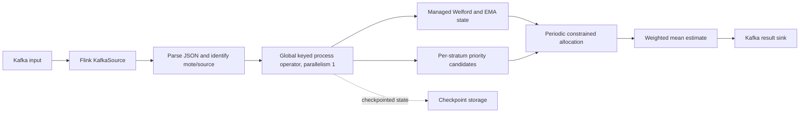

The implementation currently provides only the DV-OASRS Flink job. Exact, uniform-reservoir, OASRS, and static-VA Flink counterparts, Kafka lag, resource profiles, state-size measurements, fault recovery experiments, and end-to-end latency are not implemented.

## 6. Experimental methodology

The Python replay ran on Windows AMD64 (AMD64 Family 25 Model 117 Stepping 2, AuthenticAMD), Python 3.12.10, using the repository virtual environment. Flink/Kafka versions are specified in `flink/pom.xml` but were not executed. Synthetic streams contain 20,000 observations, five source IDs, deterministic Gaussian generation, and seeds 11, 23, 37, 53, and 71. The main budget sweep uses 200, 1,000, 2,000, and 4,000 records (1%, 5%, 10%, and 20%); it does not cover the earlier requested 40–80% budgets. There are five independent seeds. Reported cross-run intervals are 95% Student-t intervals with df=4; they are descriptive and no significance tests are asserted.

The variance-heterogeneity study fixes B=200 and varies the high-to-low within-stratum variance ratio across 1, 2, 5, 10, 50, and 100. The population-skew study uses low, moderate, high, and extreme configured source proportions. Combined skew uses 60/20/10/5/5 proportions with three higher-variance strata. The shift stream multiplies standard deviation by eight for two strata after record 10,000. Exact means/sums are computed from the complete stream independently; samplers only consume records sequentially.

The synthetic OASRS configuration receives the natural synthetic source-key registry from the controlled generator. The Intel equal-capacity OASRS capacity map is based on the observed source registry from the loaded file; this is an offline source-universe convenience and a threat to strict no-lookahead parity. DV-OASRS itself discovers `mote_id` values online and does not use final counts or the exact answers. Intel records use fields `temperature`, `humidity`, `light`, and `voltage`; allocation is driven by temperature variance for all four reported mean queries. Results are five seeds at budgets 270, 540, 1,080, and 2,160.

## 7. Results

### 7.1 Generated sampling-budget results

The table is rendered from `results/dv_oasrs/synthetic/summary.csv`; every row is five-run mean error, mean local replay throughput, and empirical interval coverage.

| Budget | Method | Mean RE | Replay records/s | 95% CI coverage |
|---|---|---|---|---|
| 200 | OASRS | 1.04% | 1,794,787 | 80.00% |
| 200 | Static VA-OASRS@500 | 1.11% | 1,013,497 | 80.00% |
| 200 | DV-OASRS@500 | 0.93% | 687,290 | 100.00% |
| 200 | Uniform Reservoir | 1.61% | 4,237,137 | — |
| 1000 | OASRS | 0.52% | 1,924,453 | 80.00% |
| 1000 | Static VA-OASRS@500 | 0.25% | 989,364 | 100.00% |
| 1000 | DV-OASRS@500 | 0.30% | 588,919 | 100.00% |
| 1000 | Uniform Reservoir | 0.55% | 3,591,534 | — |
| 2000 | OASRS | 0.33% | 1,834,765 | 80.00% |
| 2000 | Static VA-OASRS@500 | 0.16% | 934,950 | 100.00% |
| 2000 | DV-OASRS@500 | 0.33% | 490,164 | 100.00% |
| 2000 | Uniform Reservoir | 0.61% | 3,163,028 | — |
| 4000 | OASRS | 0.09% | 1,553,902 | 100.00% |
| 4000 | Static VA-OASRS@500 | 0.16% | 997,035 | 100.00% |
| 4000 | DV-OASRS@500 | 0.17% | 464,836 | 100.00% |
| 4000 | Uniform Reservoir | 0.37% | 2,277,712 | — |


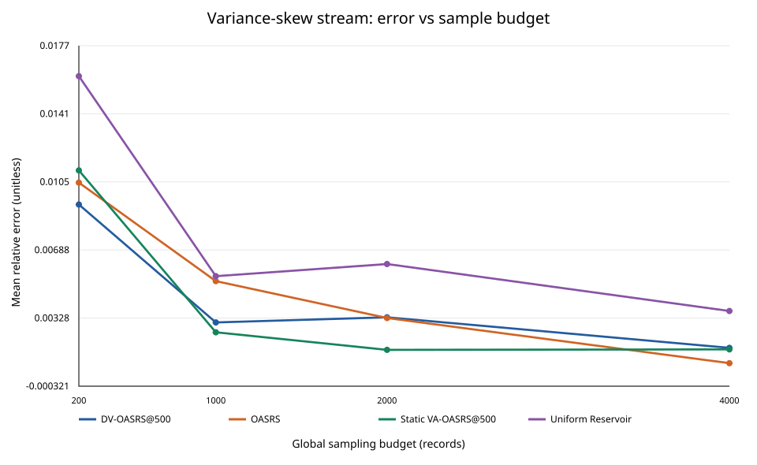
*Figure 1. Relative error for the variance-skew mean query; points show five-run means and bars show 95% Student-t intervals.*

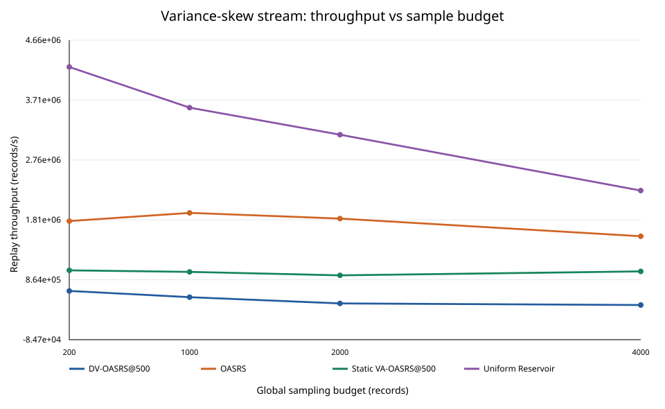
*Figure 2. Single-process Python replay throughput. This is not Flink or Kafka throughput.*

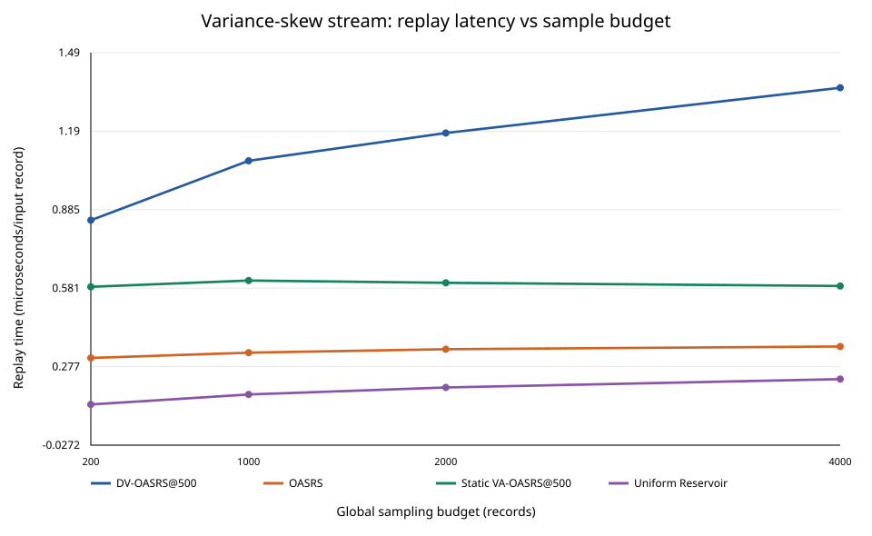
*Figure 3. Measured replay time per input record, derived as total replay time divided by input records.*

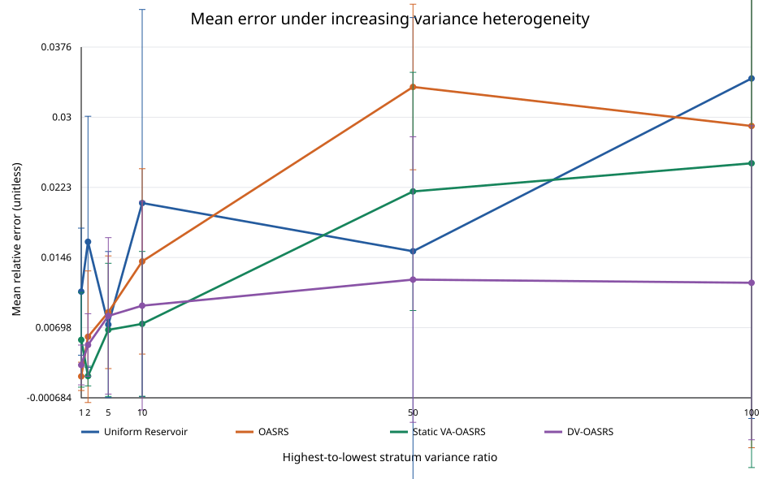
*Figure 4. Mean relative error as the high-to-low stratum variance ratio grows at a fixed budget of 200 records.*

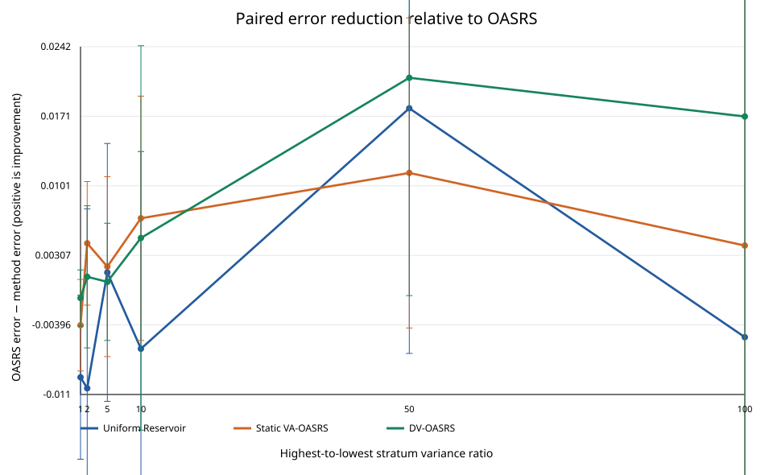
*Figure 5. Paired OASRS error minus method error over the same five seeds; positive values indicate lower error.*

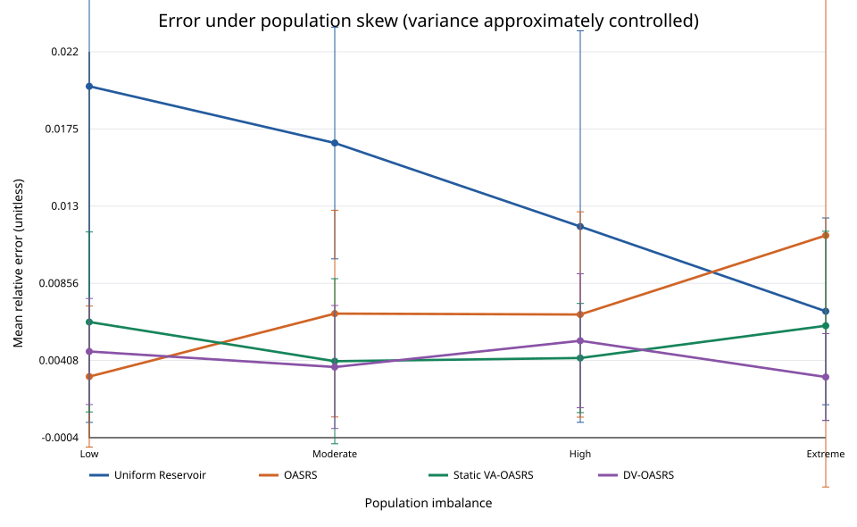
*Figure 6. Error under population imbalance while stratum variances are approximately equal.*

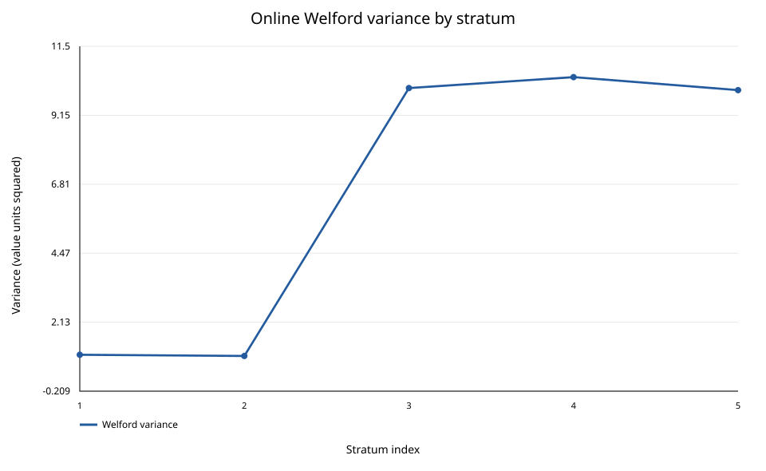
*Figure 7. Final online Welford variance by stratum for a fixed seed and budget.*

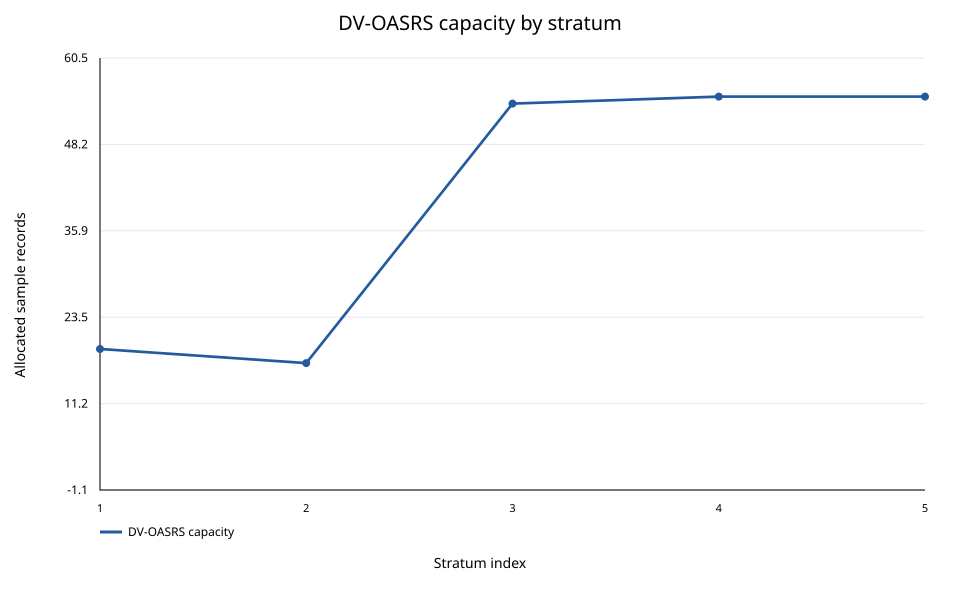
*Figure 8. Final DV-OASRS sample capacity by stratum for the same run.*

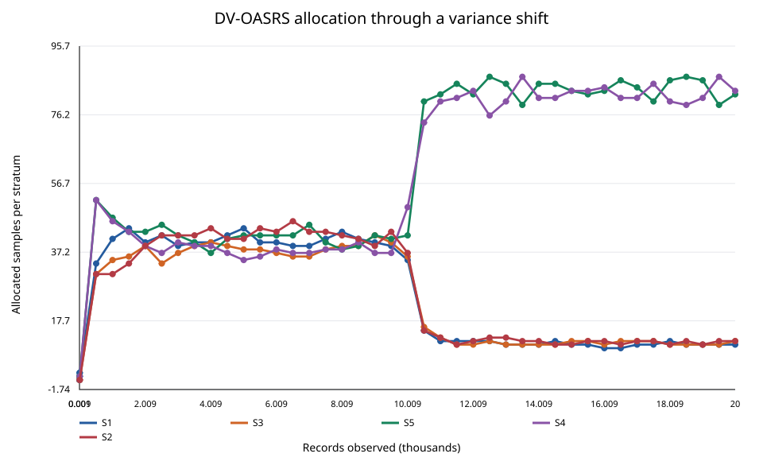
*Figure 9. DV-OASRS allocation history around the synthetic variance shift at 10,000 records.*

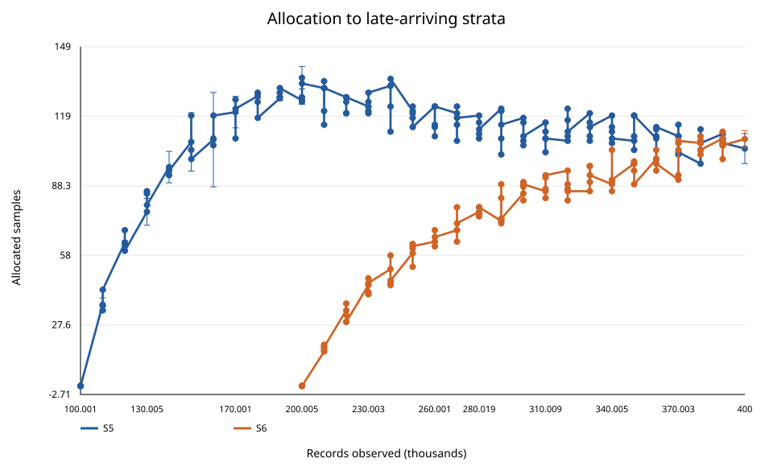
*Figure 10. Capacities assigned to S5 and S6 after their first appearances.*

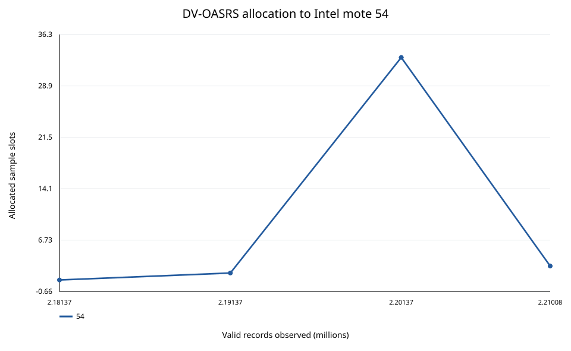
*Figure 11. DV-OASRS assigns capacity to Intel mote 54 when it first appears in the stream.*

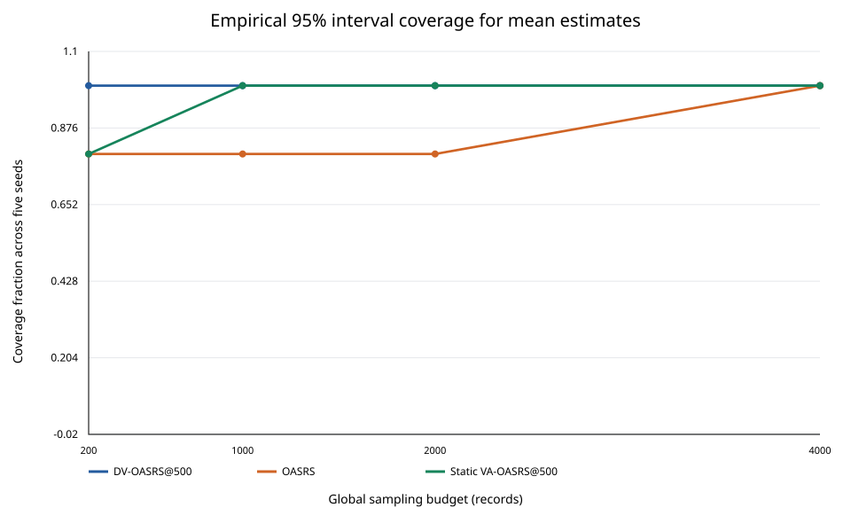
*Figure 12. Empirical coverage of the approximate 95% normal interval over five seeds.*

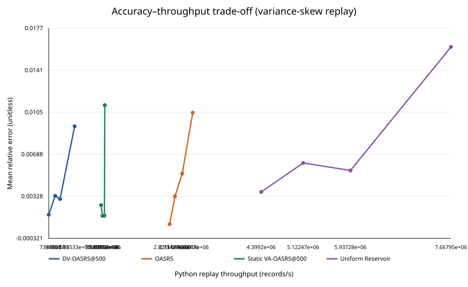
*Figure 13. Accuracy-throughput points across sample budgets. Curves are descriptive and machine-specific.*

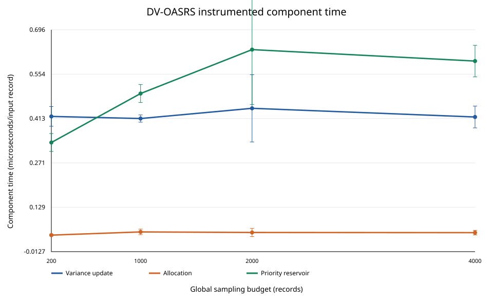
*Figure 14. Instrumented DV-OASRS variance update, allocation, and priority-reservoir time per record.*

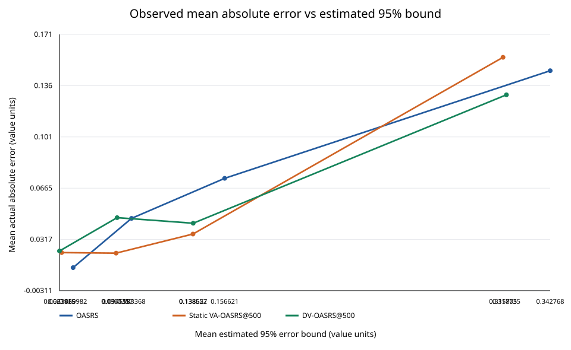
*Figure 15. Mean observed absolute error against the sampler's estimated 95% error bound, grouped by method and budget.*


### 7.2 Variance heterogeneity

The central result is conditional. DV-OASRS is worse than OASRS at ratio 1 (0.29% versus 0.17% relative error), but its five-run mean error is lower at ratios 10, 50, and 100. At ratio 100 the measured means are 1.19% for DV-OASRS versus 2.90% for OASRS, an observed 59.02% relative reduction. At ratio 2, static VA-OASRS is the lowest-error method; at ratio 5 the three stratified methods are close. The five-run intervals are broad and overlap in several cases, so these differences are descriptive, not statistically significant evidence.

| Variance ratio | Method | Mean RE | 95% t interval | Runs |
|---|---|---|---|---|
| 1 | OASRS | 0.00166 | [0.00011, 0.00321] | 5 |
| 1 | Static VA-OASRS | 0.00565 | [0.00048, 0.01083] | 5 |
| 1 | DV-OASRS | 0.00290 | [0.00072, 0.00508] | 5 |
| 1 | Uniform Reservoir | 0.01091 | [0.00397, 0.01785] | 5 |
| 2 | OASRS | 0.00599 | [0.00000, 0.01318] | 5 |
| 2 | Static VA-OASRS | 0.00170 | [0.00062, 0.00278] | 5 |
| 2 | DV-OASRS | 0.00509 | [0.00167, 0.00851] | 5 |
| 2 | Uniform Reservoir | 0.01636 | [0.00264, 0.03008] | 5 |
| 5 | OASRS | 0.00867 | [0.00251, 0.01482] | 5 |
| 5 | Static VA-OASRS | 0.00674 | [0.00000, 0.01401] | 5 |
| 5 | DV-OASRS | 0.00827 | [0.00000, 0.01682] | 5 |
| 5 | Uniform Reservoir | 0.00732 | [0.00000, 0.01530] | 5 |
| 10 | OASRS | 0.01422 | [0.00410, 0.02434] | 5 |
| 10 | Static VA-OASRS | 0.00740 | [0.00000, 0.01531] | 5 |
| 10 | DV-OASRS | 0.00938 | [0.00000, 0.02078] | 5 |
| 10 | Uniform Reservoir | 0.02059 | [0.00000, 0.04174] | 5 |
| 50 | OASRS | 0.03328 | [0.02423, 0.04232] | 5 |
| 50 | Static VA-OASRS | 0.02187 | [0.00885, 0.03488] | 5 |
| 50 | DV-OASRS | 0.01224 | [0.00000, 0.02783] | 5 |
| 50 | Uniform Reservoir | 0.01533 | [0.00000, 0.04087] | 5 |
| 100 | OASRS | 0.02901 | [0.00000, 0.06416] | 5 |
| 100 | Static VA-OASRS | 0.02494 | [0.00000, 0.05819] | 5 |
| 100 | DV-OASRS | 0.01189 | [0.00000, 0.02905] | 5 |
| 100 | Uniform Reservoir | 0.03421 | [0.00000, 0.07138] | 5 |

### 7.3 Population and combined skew

DV-OASRS improves over equal-capacity OASRS at moderate/high/extreme population skew in these generated streams, but OASRS has lower error at low skew. Static VA-OASRS edges DV-OASRS at high skew. Under combined skew at budget 200, DV-OASRS mean relative error is 0.46%, compared with 0.83% for OASRS. This one case supports the hypothesis, not universal improvement.

| Population skew | Method | Mean RE over five seeds |
|---|---|---|
| low | OASRS | 0.31% |
| low | Static VA-OASRS | 0.63% |
| low | DV-OASRS | 0.46% |
| low | Uniform Reservoir | 2.00% |
| moderate | OASRS | 0.68% |
| moderate | Static VA-OASRS | 0.40% |
| moderate | DV-OASRS | 0.37% |
| moderate | Uniform Reservoir | 1.67% |
| high | OASRS | 0.67% |
| high | Static VA-OASRS | 0.42% |
| high | DV-OASRS | 0.52% |
| high | Uniform Reservoir | 1.19% |
| extreme | OASRS | 1.13% |
| extreme | Static VA-OASRS | 0.61% |
| extreme | DV-OASRS | 0.31% |
| extreme | Uniform Reservoir | 0.69% |

### 7.4 Late-arriving strata

In the controlled six-source stream, S5 begins at record 100,000 and S6 at 200,000, with B=300 and a 10,000-record interval. DV-OASRS allocates to each new stratum on discovery; per-run first sampled-record counts are saved in the raw output. Across five seeds, its mean final capacities are 104.6 for S5 and 108.8 for S6. Static VA-OASRS assigns neither late stratum capacity and has 21.10% mean relative error; OASRS and DV-OASRS have 2.30% and 2.06% respectively. DV-OASRS uses a mean of 300 slots at completion.

| Method | Runs | Mean RE | 95% t interval | Mean sampled | Mean S5 capacity | Mean S6 capacity | S5 first sample count | S6 first sample count |
|---|---|---|---|---|---|---|---|---|
| DV-OASRS | 5 | 2.06% | [1.15%, 2.97%] | 300 | S5: 104.6 | S6: 108.8 | S5: 100008.0 | S6: 200007.4 |
| OASRS | 5 | 2.30% | [0.00%, 6.25%] | 300 | S5: 50.0 | S6: 50.0 | — | — |
| Static VA-OASRS | 5 | 21.10% | [20.30%, 21.91%] | 300 | S5: 0.0 | S6: 0.0 | — | — |

### 7.5 Distribution shift and interval sensitivity

At B=200, DV-OASRS error is 1.19% for both tested intervals (500 and 2,000); OASRS is 2.74%, static VA-OASRS is 0.94% with interval 500 and 1.25% with interval 2,000, while uniform reservoir is 0.73%. At B=4,000, static VA-OASRS at interval 500 and OASRS both outperform DV-OASRS in this run. The allocation trajectory reacts to larger post-shift variance, but no explicit drift detector or general recovery guarantee exists. We have not summarized adaptation time with a preregistered threshold; the allocation trace is provided for inspection instead.

| Budget | Method/interval | Mean relative error |
|---|---|---|
| 200 | OASRS | 2.74% |
| 200 | Static VA-OASRS@500 | 0.94% |
| 200 | DV-OASRS@500 | 1.19% |
| 200 | DV-OASRS@2000 | 1.19% |
| 200 | Uniform Reservoir | 0.73% |
| 1000 | OASRS | 0.30% |
| 1000 | Static VA-OASRS@500 | 0.49% |
| 1000 | DV-OASRS@500 | 0.96% |
| 1000 | DV-OASRS@2000 | 0.96% |
| 1000 | Uniform Reservoir | 0.65% |
| 2000 | OASRS | 0.46% |
| 2000 | Static VA-OASRS@500 | 0.41% |
| 2000 | DV-OASRS@500 | 0.53% |
| 2000 | DV-OASRS@2000 | 0.53% |
| 2000 | Uniform Reservoir | 0.36% |
| 4000 | OASRS | 0.36% |
| 4000 | Static VA-OASRS@500 | 0.10% |
| 4000 | DV-OASRS@500 | 0.24% |
| 4000 | DV-OASRS@2000 | 0.24% |
| 4000 | Uniform Reservoir | 0.52% |

### 7.6 Intel sensor dataset

The valid Intel input has 2,210,084 records and 52 observed `mote_id` strata. Sensor 54 first appears at valid position 2,181,366. DV-OASRS detects it online and gives it capacity one at its first allocation event; later allocations are recorded in `results/dv_oasrs/intel/allocation_over_time.csv`. However, across all four budgets it has higher temperature mean error than equal-capacity OASRS and uniform reservoir. At B=270 the errors are 8.34%, 7.73%, and 3.19%, respectively. Thus the late-stratum handling works in the trace, while the accuracy result is negative for this workload. The static VA Intel run with 94.73% error is retained as an invalid historical failure and is excluded.

| Budget | Method | Temperature mean RE | Replay records/s | 95% interval coverage |
|---|---|---|---|---|
| 270 | OASRS-equal | 7.73% | 2,865,229 | 80.00% |
| 270 | DV-OASRS | 8.34% | 769,109 | 80.00% |
| 270 | Uniform Reservoir | 3.19% | 4,917,031 | 100.00% |
| 540 | OASRS-equal | 5.48% | 2,779,053 | 60.00% |
| 540 | DV-OASRS | 9.49% | 804,515 | 40.00% |
| 540 | Uniform Reservoir | 3.31% | 5,212,464 | 100.00% |
| 1080 | OASRS-equal | 2.88% | 2,881,898 | 80.00% |
| 1080 | DV-OASRS | 7.38% | 781,123 | 40.00% |
| 1080 | Uniform Reservoir | 1.46% | 5,081,807 | 100.00% |
| 2160 | OASRS-equal | 3.00% | 2,811,124 | 60.00% |
| 2160 | DV-OASRS | 5.79% | 737,900 | 40.00% |
| 2160 | Uniform Reservoir | 1.65% | 4,997,097 | 100.00% |

Mean relative error for all four Intel numeric queries:

| Budget | Method | Temperature | Humidity | Light | Voltage |
|---|---|---|---|---|---|
| 270 | OASRS-equal | 7.73% | 2.82% | 4.45% | 0.58% |
| 270 | DV-OASRS | 8.34% | 2.66% | 7.84% | 0.43% |
| 270 | Uniform Reservoir | 3.19% | 2.13% | 7.32% | 0.15% |
| 540 | OASRS-equal | 5.48% | 1.29% | 2.45% | 0.38% |
| 540 | DV-OASRS | 9.49% | 3.57% | 9.17% | 0.46% |
| 540 | Uniform Reservoir | 3.31% | 1.67% | 3.19% | 0.24% |
| 1080 | OASRS-equal | 2.88% | 1.27% | 3.85% | 0.26% |
| 1080 | DV-OASRS | 7.38% | 2.85% | 9.88% | 0.39% |
| 1080 | Uniform Reservoir | 1.46% | 0.81% | 3.29% | 0.15% |
| 2160 | OASRS-equal | 3.00% | 1.15% | 3.71% | 0.22% |
| 2160 | DV-OASRS | 5.79% | 2.55% | 8.72% | 0.20% |
| 2160 | Uniform Reservoir | 1.65% | 0.66% | 2.57% | 0.14% |

Per-stratum DV-OASRS population, capacity, and actual retained count are saved in `results/dv_oasrs/intel/sample_counts.csv` for each seed and budget. First appearance position for each of the 52 observed sensors is in `first_appearance.csv`.

### 7.7 Throughput, overhead, and Pareto analysis

On the variance-skew Python replay at B=200, DV-OASRS processes 0.69 million records/s, OASRS 1.79 million, static VA-OASRS 1.01 million, uniform reservoir 4.24 million, and exact processing 18.17 million. Increasing the sample budget also grows priority maintenance and lowers measured Python throughput. These are local single-process replay rates and include the implementation's Python bookkeeping; they are not comparable to Flink throughput. DV-OASRS's estimated candidate-pool byte count is a shallow Python object estimate only, not a process memory profile.

| Method | Mean replay records/s | Microseconds/input record | Mean RE |
|---|---|---|---|
| DV-OASRS@500 | 687,290 | 1.459 | 0.93% |
| Exact | 18,170,079 | 0.062 | 0.00% |
| OASRS | 1,794,787 | 0.571 | 1.04% |
| Static VA-OASRS@500 | 1,013,497 | 0.992 | 1.11% |
| Uniform Reservoir | 4,237,137 | 0.247 | 1.61% |

### 7.7.1 Final method comparison

This comparison uses the variance-skew synthetic workload at B=200 (1% of 20,000 records). Memory was not measured consistently across methods; it is therefore not numerically populated.

| Method | Sampling strategy | Variance aware | Dynamic allocation | Replay records/s | Mean RE | Memory |
|---|---|---|---|---|---|---|
| Exact | Full stream | — | — | 18,170,079 | 0.00% | Not applicable |
| Uniform Reservoir | Global priority/reservoir sample | No | No | 4,237,137 | 1.61% | Not measured |
| OASRS | Equal-capacity stratified Algorithm R | No | No | 1,794,787 | 1.04% | Not measured |
| Static VA-OASRS@500 | One-shot variance-aware stratified | Yes | No | 1,013,497 | 1.11% | Not measured |
| DV-OASRS@500 | Dynamic priority stratified | Yes | Yes | 687,290 | 0.93% | Not measured |

The Pareto figure shows an unfavorable throughput trade-off for DV-OASRS in this prototype. Raw DV results record variance-update time, allocation time, priority-reservoir time, allocation event count, and a shallow candidate-pool memory estimate. These instrumentation timings do not include JVM/Flink execution and can be noisy at Python timer granularity. Dynamic priority state can grow to X times B candidate references, a key cost of preserving correct resizing semantics. CPU utilization, resident memory, checkpoint size, Kafka lag, and end-to-end latency were not measured. No resource conclusion can be drawn from the Python throughput plot alone.

### 7.8 Confidence intervals

The sampler reports a normal-approximation error interval using the existing StreamApprox-style stratified sample-variance estimator. Across the five-seed variance-skew sweep, DV-OASRS coverage ranges from 100.00% to 100.00%; at B=200 it is 100.00%. Five repetitions are too few for calibrated coverage claims. The normal interval is an estimate, not a rigorous finite-sample guarantee. Coverage and raw per-seed errors are in the CSVs.

## 8. Ablation study

The available three-way comparison is OASRS (no variance), static VA-OASRS (variance and one-shot allocation), and DV-OASRS (variance plus periodic reallocation), with a uniform reservoir reference. We did not add a separate OASRS-plus-variance-tracking/no-allocation variant, so pure variance-tracking compute cost is not isolated. Static and dynamic comparison does not show a uniform dynamic advantage: static wins on some distributions and budgets, while DV wins on selected high-heterogeneity and skew cases.

## 9. Discussion

Variance-aware dynamic allocation helps in the evaluated synthetic cases when one or more strata have substantially higher within-stratum variance and the online variance estimate has time to respond. It does not help under equal variance (ratio 1), does not consistently beat static VA-OASRS, and does not beat uniform reservoir or OASRS for Intel temperature means. Reallocation and priority retention also reduce throughput substantially in this Python implementation. New-source discovery is the clearest functional improvement over static VA-OASRS; the evidence does not establish that this benefit is worth the cost for production use.

## 10. Limitations

The priority pool is O(XB) in the worst case. A global budget smaller than the number of active strata is rejected. Allocation is query-field dependent; Intel allocations use temperature variance for humidity, light, and voltage too. Evaluation covers mean and sum, not a full histogram suite or dedicated approximate COUNT query. The synthetic shift has one form and does not test a drift detector. There are five seeds, only four sampling budgets, and no statistical significance test. The Intel OASRS capacity map uses an offline observed source registry; DV-OASRS does not. Flink source is uncompiled/unrun, single-parallelism, and only DV-OASRS is implemented there. No end-to-end or resource benchmark is available.

## 11. Threats to validity

Gaussian synthetic sources, chosen means, and variance patterns may not represent operational data. A fixed random-priority method and only five seeds leave substantial Monte Carlo uncertainty. The Intel file's record order and query distributions may not represent live Kafka arrival. The OASRS cost function in the paper is delegated to an implementation-specific hook, so our equal-capacity control is one defensible baseline, not the only OASRS allocation. Python timing is sensitive to interpreter/host and cannot predict Flink throughput. Confidence coverage estimates are based on very few repetitions and use an approximate normal interval.

## 12. Conclusion

The Python implementation demonstrates statistically defensible dynamic capacity changes using independent priorities and successfully assigns samples to late-arriving strata. On synthetic streams, DV-OASRS reduces error versus equal-capacity OASRS at high variance heterogeneity, but it regresses at the homogeneous endpoint and does not consistently improve over static VA-OASRS. On Intel temperature means it is less accurate and slower than the OASRS/uniform controls. Therefore, the research question has a conditional answer: online variance allocation can help under selected heterogeneous synthetic distributions, but this study does not establish a significant overall accuracy/performance improvement or justify its overhead for the Intel workload. A compiled, fault-tested Flink implementation with matched baseline jobs and resource instrumentation is required before drawing a systems conclusion.

## Reproducibility and artifacts

- Raw and processed synthetic measurements: `results/dv_oasrs/synthetic/`
- Intel measurements and first-appearance positions: `results/dv_oasrs/intel/`
- Late-stratum experiment: `results/dv_oasrs/late-strata/`
- Generated figures: `results/dv_oasrs/plots/`
- Python benchmark: `experiments/va_oasrs/benchmark.py`
- Plot generator: `experiments/va_oasrs/dv_plots.py`
- Report generator: `experiments/va_oasrs/build_report.py`
- DV-OASRS implementation: `src/streamapprox/dv_oasrs.py`
- Flink reference job: `flink/src/main/java/org/streamapprox/flink/DVOASRSJob.java`

## References

Do Le Quoc, Ruichuan Chen, Pramod Bhatotia, Christof Fetzer, Volker Hilt, and Thorsten Strufe. “StreamApprox: Approximate Computing for Stream Analytics.” ACM Middleware 2017. DOI: [10.1145/3135974.3135989](https://doi.org/10.1145/3135974.3135989).
